# Modelo de datos

Este es el modelo de la base de datos del backend (Postgres en Railway, SQLite en local).
Cada dato se guarda **una sola vez**; lo que se puede calcular (semana de embarazo, número de
cirugías, tipo de cuenta) no se guarda.

```mermaid
erDiagram
    USER ||--|| PROFILE : tiene
    USER ||--o| MEDICAL_INFO : tiene
    USER ||--o{ DAILY_LOG : registra
    USER ||--o{ REMINDER : programa
    USER ||--o{ DOCTOR : guarda
    USER ||--o{ MYTH_ANSWER : responde
    USER ||--o{ CHAT_SUMMARY : tiene
    DAILY_LOG ||--o{ DAILY_LOG_SYMPTOM : incluye
    SYMPTOM ||--o{ DAILY_LOG_SYMPTOM : "aparece en"
    MEDICAL_INFO ||--o{ SURGERY : lista
    MEDICAL_INFO ||--o{ MEDICAL_INFO_SYMPTOM : "síntomas habituales"
    SYMPTOM ||--o{ MEDICAL_INFO_SYMPTOM : "aparece en"

    USER {
        int id PK
        string email UK "se usa para iniciar sesión"
        string first_name
        string last_name
        string password "hash, nunca en texto plano"
    }
    PROFILE {
        int user_id FK "uno por usuaria"
        string phone
        date birth_date
        string health_stage "menstruacion | embarazo | menopausia"
        bool onboarding_complete
        date cycle_tracking_start
        date pregnancy_start_date "la semana se calcula desde aquí"
        string app_language "es | mis | en"
        string audio_language "es | none"
    }
    DAILY_LOG {
        int id PK
        int user_id FK
        date date "UNIQUE(user_id, date)"
        string stage
        string mood "very_happy | good | neutral | tired | sad | very_sad | angry"
        bool exercise
        text notes
        bool period "menstruación"
        bool baby_movement "embarazo"
        bool doctor_appointment "embarazo"
        bool took_vitamins "menopausia"
        datetime created_at
        datetime updated_at
    }
    SYMPTOM {
        int id PK
        string code UK "ej. headache, hot_flashes"
        bool for_menstruation
        bool for_pregnancy
        bool for_menopause
        int sort_order
    }
    DAILY_LOG_SYMPTOM {
        int id PK
        int daily_log_id FK
        int symptom_id FK "o bien..."
        string custom_label "...texto libre (solo uno de los dos)"
    }
    REMINDER {
        int id PK
        int user_id FK
        string kind "appointment | supplement"
        string name
        datetime scheduled_at
        text description
        string reminder_offset "5min ... 1week | none"
        datetime created_at
        datetime updated_at
    }
    DOCTOR {
        int id PK
        int user_id FK
        string name
        string professionalism
        string phonenumber
        text details
        datetime created_at
        datetime updated_at
    }
    MYTH_ANSWER {
        int id PK
        int user_id FK
        date date "UNIQUE(user_id, date)"
        int flashcard_id
        bool answered_true
    }
    CHAT_SUMMARY {
        int id PK
        int user_id FK
        date date "UNIQUE(user_id, date)"
        text text
        datetime updated_at
    }
    MEDICAL_INFO {
        int user_id FK "uno por usuaria"
        string occupation
        string city
        string insurance
        string emergency_name
        string emergency_phone
        decimal height_cm
        decimal weight_kg
        string blood_type "A+ ... O-"
        text current_illnesses
        int age_at_first_period
        int cycle_length_days
        int bleeding_days
        int menstrual_pain_level "1 a 5"
        int pregnancies
        text medications
        text allergies
        datetime updated_at
    }
    SURGERY {
        int id PK
        int medical_info_id FK
        string reason
        date performed_on
    }
    MEDICAL_INFO_SYMPTOM {
        int id PK
        int medical_info_id FK
        string stage
        int symptom_id FK "o bien..."
        string custom_label "...texto libre (solo uno de los dos)"
    }
```

## Reglas que garantiza la base de datos

- **Un registro diario por usuaria y fecha.** Dos usuarias pueden registrar el mismo día; la misma usuaria no puede tener dos registros para un día.
- **Cada síntoma es del catálogo o texto libre, nunca los dos ni ninguno.** El mismo síntoma no se repite dentro de un registro.
- **Cada usuaria solo ve sus propios datos.** La API filtra todo por la usuaria del token.
- **Valores con opciones fijas** (etapa, ánimo, tipo de sangre, nivel de dolor, aviso del recordatorio) se validan: un valor fuera de la lista devuelve un error 400.

## Lo que se queda solo en el teléfono

No se sincroniza porque solo tiene sentido en ese dispositivo:

- Los identificadores de notificaciones programadas.
- La ruta local de la foto de perfil.
- Los tokens de sesión y las preferencias de la interfaz (por ejemplo, qué tarjeta ya se mostró hoy).

## Cambios respecto al modelo anterior

| Antes | Ahora |
|---|---|
| `MenstruationEntry`, `PregnancyEntry`, `MenopauseEntry`, `MoodEntry` (y `calendar_entries` en la app) | `DailyLog`: un registro por día con los campos de cada etapa |
| Listas de síntomas en JSON | Tabla `Symptom` + `DailyLogSymptom` / `MedicalInfoSymptom` |
| `Appointment` y `Supplement` (misma estructura) | `Reminder` con `kind` |
| Nombre, teléfono, correo y nacimiento repetidos en `Profile`, `MedicalInfo` y `User` | Nombre y correo en `User`; teléfono y nacimiento en `Profile` |
| Altura, peso, duración del ciclo, etc. como texto | Números (`height_cm`, `cycle_length_days`, ...) |
| `Cirugia.date` como texto | `Surgery.performed_on` como fecha |
| `pregnancy_week`, `account_type`, `surgeryCount` guardados | Se calculan |

La migración `0006_copy_legacy_data` pasa los datos existentes al modelo nuevo antes de que
`0008_redesign_drop_legacy` borre las tablas y columnas antiguas.
